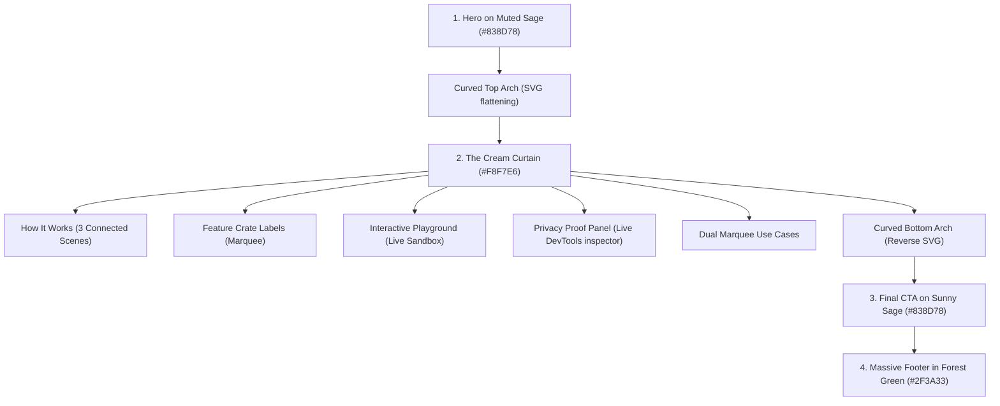

# MDstash Landing Page — Complete 1:1 UI/UX, Motion & Architecture Specification

> **Target Audience:** Any AI coding assistant, autonomous agent, or frontend engineer tasked with rebuilding the MDstash landing page on another platform or codebase with **100% exact fidelity** — matching colors, typography, textures, component trees, physics-based scroll transitions, GSAP timelines, SVG paths, and micro-interactions.

---

## Table of Contents
1. [Core Design Tokens & Theme System](#1-core-design-tokens--theme-system)
2. [Typography & Self-Hosted Font Stack](#2-typography--self-hosted-font-stack)
3. [Paper Grain Texture & Material System](#3-paper-grain-texture--material-system)
4. [Page Architecture & Visual Rhythm](#4-page-architecture--visual-rhythm)
5. [FOUC Prevention & Page Initialization](#5-fouc-prevention--page-initialization)
6. [Smooth Scrolling & ScrollTrigger Integration (Lenis + GSAP)](#6-smooth-scrolling--scrolltrigger-integration-lenis--gsap)
7. [Component Specification: Fixed Navigation (`LandingNav`)](#7-component-specification-fixed-navigation-landingnav)
8. [Component Specification: The Brew District Badge](#8-component-specification-the-brew-district-badge)
9. [Component Specification: Fullscreen Menu Drawer (`MenuOverlay`)](#9-component-specification-fullscreen-menu-drawer-menuoverlay)
10. [Component Specification: Hero Section (`HeroSection`)](#10-component-specification-hero-section-herosection)
11. [Hero Intro Timeline & Typed Highlight Sequence](#11-hero-intro-timeline--typed-highlight-sequence)
12. [The Cream Curtain & Elliptical Morphing Arches](#12-the-cream-curtain--elliptical-morphing-arches)
13. [Component Specification: How It Works Story (`HowItWorksStory`)](#13-component-specification-how-it-works-story-howitworksstory)
14. [SVG Dynamic Spline Path Connector & LUT Particle Physics](#14-svg-dynamic-spline-path-connector--lut-particle-physics)
15. [Component Specification: Feature Crate Labels (`FeatureCrateLabels`)](#15-component-specification-feature-crate-labels-featurecratelabels)
16. [Component Specification: Interactive Playground (`InteractivePlayground`)](#16-component-specification-interactive-playground-interactiveplayground)
17. [Component Specification: Privacy Proof Panel (`PrivacyProofPanel`)](#17-component-specification-privacy-proof-panel-privacyproofpanel)
18. [Component Specification: Dual Marquee Use Cases (`MarqueeUseCases`)](#18-component-specification-dual-marquee-use-cases-marqueeusecases)
19. [Component Specification: Final CTA & Forest Footer](#19-component-specification-final-cta--forest-footer)
20. [Accessibility, Reduced Motion & Performance Flags](#20-accessibility-reduced-motion--performance-flags)
21. [Step-by-Step Implementation Recipe for an AI Agent](#21-step-by-step-implementation-recipe-for-an-ai-agent)

---

## 1. Core Design Tokens & Theme System

The design aesthetic is inspired by vintage industrial packaging, artisanal brewery crate stenciling, warm paper ephemera, and tactile mid-century stationery. It is **not** a generic dark mode or stark corporate SaaS theme.

### 1.1 Color Palette Table

| Token Variable | Hex Value | Role / Usage |
| :--- | :--- | :--- |
| `--sage` | `#838D78` | Primary canvas mid-tone background (Hero, Final CTA). Mid-value olive-sage. |
| `--sage-deep` | `#5E6A54` | Deeper shade of sage for borders, shadows, and secondary backgrounds. |
| `--cream` | `#F8F7E6` | High-contrast warm cream text on sage; primary background of "The Cream Curtain". |
| `--cream-dim`| `#E6E4D1` | Dimmed cream for subtle borders, secondary labels, and card fills. |
| `--cream-card`| `#FDFAF2`| Ultra-clean cream surface for floating cards and preview badges. |
| `--oat` | `#D8D3BC` | Warm oat paper card surface (L ~ 79.2%); high contrast with ink. |
| `--oat-light`| `#E2DEC9` | Slightly lighter oat for badge strips and input container backgrounds. |
| `--orange` | `#EEB257` | Primary craft accent (warm marigold/amber orange). Used for highlights, active states, CTA buttons, and interactive pins. |
| `--orange-deep`| `#D99E41`| Darker amber orange for button hover states and pressed shadows. |
| `--forest` | `#2F3A33` | Deep pine/charcoal forest green (Footer background, button text on orange). |
| `--forest-dark`| `#242C27`| Darkest forest shade for bottom footers and recessed card wells. |
| `--ink` | `#26332A` | Primary typography color when on cream or oat backgrounds. |
| `--danger` | `#A8382A` | Muted brick/clay red for destructive actions and alerts. |

### 1.2 Borders, Lines & Scrim

```css
:root {
  --line: rgba(248, 247, 230, 0.28);        /* White-cream hairline border on sage */
  --line-light: rgba(248, 247, 230, 0.15);  /* Fainter hairline divider on sage */
  --line-ink: rgba(38, 51, 42, 0.18);       /* Ink hairline border on cream */
  --scrim: rgba(38, 51, 42, 0.40);          /* Modal backdrop overlay */
  --dialog-bg: #D8D3BC;                     /* Modal surface */
  --field-bg: #CBC5AB;                      /* Input fields */
  --field-border: rgba(38, 51, 42, 0.20);
  
  --nav-color-duration: 150ms;
  --nav-color-ease: cubic-bezier(0.4, 0, 0.2, 1);
}
```

### 1.3 Tailwind Configuration Mappings

```typescript
// tailwind.config.ts
import type { Config } from 'tailwindcss';

export default {
  content: ['./index.html', './src/**/*.{js,ts,jsx,tsx}'],
  theme: {
    extend: {
      colors: {
        sage: {
          DEFAULT: '#838D78',
          deep: '#5E6A54',
        },
        forest: {
          DEFAULT: '#2F3A33',
          light: '#3A4840',
          dark: '#242C27',
        },
        cream: {
          DEFAULT: '#F8F7E6',
          dim: '#E6E4D1',
          faint: 'rgba(246, 241, 220, 0.1)',
        },
        oat: {
          DEFAULT: '#D8D3BC',
          light: '#E2DEC9',
        },
        orange: {
          DEFAULT: '#EEB257',
          deep: '#D99E41',
          light: '#F5B85D',
        },
        ink: {
          DEFAULT: '#26332A',
        },
        line: {
          DEFAULT: 'var(--line)',
          ink: 'var(--line-ink)',
        },
      },
      fontFamily: {
        display: ['var(--font-display)', 'sans-serif'],
        sans: ['"Nunito"', 'system-ui', '-apple-system', 'sans-serif'],
        mono: ['"JetBrains Mono"', 'ui-monospace', 'SFMono-Regular', 'Menlo', 'monospace'],
      },
      boxShadow: {
        stamp: '0 2px 0 0 rgba(0,0,0,0.15)',
        card: '0 8px 24px -4px rgba(25, 32, 28, 0.35)',
        glow: '0 0 24px -2px rgba(242, 163, 58, 0.35)',
      },
    },
  },
} satisfies Config;
```

---

## 2. Typography & Self-Hosted Font Stack

Typography is the defining characteristic of this interface. Three distinct families are used:

### 2.1 Display Font: `Chelsea Market`
- **Role:** Hero headlines, brand badge, section titles, giant wordmarks, button labels.
- **Visual Personality:** Quirky, artisanal stenciled woodblock feel. Medium-bold (~1/4 cap height stroke weight), near-monoline, rounded terminals, open letters, low crossbars, tight letter-spacing.
- **CSS Definition:**
  ```css
  :root {
    --font-display: 'Chelsea Market', cursive, sans-serif;
  }
  .font-display {
    font-family: var(--font-display);
    letter-spacing: -0.01em;
  }
  ```
- **Fallback / Drop-in Alternative:** `@fontsource/chelsea-market/400.css` or drop `custom-display.woff2` into `/public/fonts/`.

### 2.2 Body Font: `Nunito`
- **Role:** Body copy, descriptions, navigation items, secondary metadata.
- **Weights:** 400 (Regular), 600 (Semi-bold), 700 (Bold).
- **Import:** `@fontsource/nunito/400.css`, `@fontsource/nunito/600.css`, `@fontsource/nunito/700.css`.

### 2.3 Monospace Font: `JetBrains Mono`
- **Role:** Markdown code snippets, file names (`CLAUDE.md`, `.cursorrules`), tags, copy mode toggles.
- **Weights:** 400 (Regular), 500 (Medium).
- **Import:** `@fontsource/jetbrains-mono/400.css`, `@fontsource/jetbrains-mono/500.css`.

---

## 3. Paper Grain Texture & Material System

To prevent the flat digital look, the entire viewport uses a dual-layer hardware-accelerated paper grain overlay.

### 3.1 Global Grain Overlay (`.grain-overlay`)

```css
.grain-overlay {
  position: fixed;
  inset: 0;
  width: 100vw;
  height: 100vh;
  pointer-events: none;
  z-index: 25; /* Sits above page content (z-10), below cursor overlay and navigation (z-40) */
  contain: strict;
}

/* Layer 1: Fine paper tooth */
.grain-overlay::before {
  content: '';
  position: absolute;
  inset: 0;
  background-image: url('/textures/paper-fine.png');
  background-repeat: repeat;
  background-size: 512px 512px;
  mix-blend-mode: normal;
  opacity: 0.11;
  pointer-events: none;
}

/* Layer 2: Sparse organic paper flecks */
.grain-overlay::after {
  content: '';
  position: absolute;
  inset: 0;
  background-image: url('/textures/paper-fleck.png');
  background-repeat: repeat;
  background-size: 512px 512px;
  mix-blend-mode: normal;
  opacity: 0.04;
  pointer-events: none;
}
```

### 3.2 Component Paper Texture Utility (`.bg-paper-grain`)
Applied to interactive cards, trays, and modals:
```css
.bg-paper-grain {
  background-image: url('/textures/paper-fine.png');
  background-repeat: repeat;
  background-size: 512px 512px;
  opacity: 0.11;
  pointer-events: none;
}
```

---

## 4. Page Architecture & Visual Rhythm

The landing page is organized as a dynamic sandwich of contrasting material surfaces:



### Complete Page Structure in `Landing.tsx`
```tsx
export const Landing: React.FC = () => {
  return (
    <div className="min-h-screen bg-sage text-cream selection:bg-orange selection:text-forest overflow-x-hidden relative">
      <LandingNav theme={navTheme} onNavigateSection={handleScrollTo} />

      {/* 1. HERO ON MUTED SAGE */}
      <main id="main-content" ref={heroRef} className="pt-[clamp(76px,6.2vw,155px)] will-change-transform">
        <HeroSection onScrollNext={() => handleScrollTo('#cream-curtain')} />
      </main>

      {/* 2. THE CREAM CURTAIN */}
      <div id="cream-curtain" ref={creamCurtainRef} className="relative bg-cream text-ink transition-colors duration-300">
        {/* Curved Elliptical Top Arch that Flattens as it Rises */}
        <div className="curtain-arch overflow-hidden w-full leading-none -mt-1 pointer-events-none">
          <svg viewBox="0 0 1440 100" preserveAspectRatio="none" className="w-full h-16 sm:h-24 md:h-32 text-cream fill-current block" aria-hidden="true">
            <path d="M0 100C360 0 1080 0 1440 100V100H0Z" />
          </svg>
        </div>

        <HowItWorksStory />
        <FeatureCrateLabels />
        <InteractivePlayground />
        <PrivacyProofPanel />
        <MarqueeUseCases />

        {/* Reverse Arch: Cream Transitioning into Sage */}
        <div className="curtain-arch-reverse overflow-hidden w-full leading-none -mb-1 pointer-events-none">
          <svg viewBox="0 0 1440 100" preserveAspectRatio="none" className="w-full h-16 sm:h-24 md:h-32 text-sage fill-current block" aria-hidden="true">
            <path d="M0 0C360 100 1080 100 1440 0V100H0Z" />
          </svg>
        </div>
      </div>

      {/* 3. FINAL CTA ON SAGE */}
      <section ref={finalCtaRef} className="py-24 sm:py-32 bg-sage text-cream border-t border-line text-center px-6 relative z-10">
        {/* ... */}
      </section>

      {/* 4. FOOTER IN FOREST */}
      <footer className="border-t border-line pt-12 pb-0 px-6 bg-forest text-xs text-cream relative z-10 overflow-hidden">
        {/* Giant 19vw cropped wordmark at bottom */}
      </footer>
    </div>
  );
};
```

---

## 5. FOUC Prevention & Page Initialization

To prevent the page from showing untransformed headline lines or jumping elements before GSAP initializes, an inline `<style>` and `<script>` are embedded in `index.html`.

### 5.1 Inline CSS in `index.html` `<head>`
```html
<style>
  html, body {
    background-color: #838D78;
  }
  /* Prevent flash of un-animated content before intro timeline runs */
  .is-loading .hero-line-inner {
    opacity: 0;
    visibility: hidden;
  }
  .is-loading .nav-rule-left,
  .is-loading .nav-rule-right,
  .is-loading .nav-badge,
  .is-loading .hero-scroll-cue,
  .is-loading .hero-right-tab,
  .is-loading .hero-crate,
  .is-loading .hero-motif-left,
  .is-loading .hero-motif-right,
  .is-loading .hero-caption-left,
  .is-loading .hero-caption-right {
    opacity: 0;
    visibility: hidden;
  }
</style>
```

### 5.2 Inline Script in `index.html`
```html
<script>
  if ('scrollRestoration' in history) {
    history.scrollRestoration = 'manual';
  }
  window.scrollTo(0, 0);

  // If URL has ?nointro or user prefers reduced motion or route is not '/', unhide immediately
  if (window.location.pathname !== '/' || new URLSearchParams(window.location.search).has('nointro') || (window.matchMedia && window.matchMedia('(prefers-reduced-motion: reduce)').matches)) {
    document.documentElement.classList.remove('is-loading');
  }

  // 3s failsafe timeout so content is never permanently hidden if JS crashes
  setTimeout(function() {
    document.documentElement.classList.remove('is-loading');
  }, 3000);
</script>
```

---

## 6. Smooth Scrolling & ScrollTrigger Integration (Lenis + GSAP)

Smooth momentum scrolling is powered by `@studio-freight/lenis` (or `lenis`), tightly coupled with `gsap/ScrollTrigger`.

### 6.1 Lenis Configuration & GSAP Ticker Synchronization
In `useLandingScroll.ts`:
```typescript
import Lenis from 'lenis';
import gsap from 'gsap';
import { ScrollTrigger } from 'gsap/ScrollTrigger';

gsap.registerPlugin(ScrollTrigger);

// 1. Initialize Lenis instance
const lenis = new Lenis({
  duration: 1.05,
  wheelMultiplier: 1,
  smoothWheel: true,
  easing: (t) => Math.min(1, 1.001 - Math.pow(2, -10 * t)),
});

// 2. Synchronize Lenis with ScrollTrigger
lenis.on('scroll', ScrollTrigger.update);

const tickerCallback = (time: number) => {
  lenis.raf(time * 1000);
};

gsap.ticker.add(tickerCallback);
gsap.ticker.lagSmoothing(0);
```

### 6.2 Zero-React-Rerender Theme Switching Architecture
Instead of dispatching React state on every scroll tick, the theme flips via DOM data attributes:
```typescript
const updateNavTheme = (theme: 'sage' | 'cream') => {
  const nav = document.querySelector('[data-testid="landing-nav"]') as HTMLElement | null;
  if (nav && nav.getAttribute('data-theme') !== theme) {
    nav.setAttribute('data-theme', theme);
  }
};

ScrollTrigger.create({
  trigger: creamCurtainRef.current,
  start: 'top 60px',
  end: 'bottom 60px',
  onEnter: () => updateNavTheme('cream'),
  onLeaveBack: () => updateNavTheme('sage'),
  onLeave: () => updateNavTheme('sage'),
  onEnterBack: () => updateNavTheme('cream'),
});
```

---

## 7. Component Specification: Fixed Navigation (`LandingNav`)

The navigation sits fixed at `top: 0` (`z-40`). It features a split layout flanking a centered vintage stenciled badge.

### 7.1 Visual Layout Grid
- **Height:** Responsive clamped height: `clamp(68px, 5.2vw, 110px)`.
- **Side Padding:** `clamp(16px, 1.7vw, 44px)`.
- **Left Zone:**
  - `Home` text link in `Chelsea Market` display font.
  - Outlined circular button: GitHub repository icon (`clamp(34px, 2.5vw, 64px)`).
  - Outlined circular button: Back-to-top arrow (`ArrowUp`).
- **Center Zone:**
  - Centered `BrewDistrictBadge` hanging down from the top edge.
- **Right Zone:**
  - Orange CTA pill: `"Open MDstash"` (`font-display`, rounded-full, `px-[clamp(16px,1.6vw,32px)]`).
  - Outlined circular button: Shield icon linking to `/privacy`.
  - Outlined pill button: `"Menu"` drawer toggle.

### 7.2 Frosted Glass Layer (`.nav-glass`)
The background is rendered in a separate absolute layer to avoid backdrop filter artifact bugs:
```css
.nav-glass {
  background: color-mix(in srgb, var(--surface) 58%, transparent);
  -webkit-backdrop-filter: none;
  backdrop-filter: none;
  border-bottom: 1px solid var(--line);
  box-shadow: 0 4px 20px -2px rgba(25, 32, 28, 0.12);
  transition-property: background-color, border-color, background, opacity;
  transition-duration: 150ms;
}

nav[data-scrolled="true"] .nav-glass {
  opacity: 1;
  -webkit-backdrop-filter: blur(8px);
  backdrop-filter: blur(8px);
}

nav[data-scrolled="false"] .nav-glass {
  opacity: 0;
  -webkit-backdrop-filter: none;
  backdrop-filter: none;
}
```

---

## 8. Component Specification: The Brew District Badge

The brand mark centered in the navigation is an SVG badge modeled after vintage brewery barrel tags with stenciled lettering and a swallowtail ribbon tab.

```xml
<svg
  viewBox="0 0 100 114"
  fill="none"
  xmlns="http://www.w3.org/2000/svg"
  className="w-full h-full overflow-visible"
  aria-hidden="true"
>
  <!-- 1. Outer Frame: Solid outline frame, 4px stroke -->
  <rect x="4" y="4" width="92" height="92" stroke="currentColor" strokeWidth="4" fill="transparent" />

  <!-- 2. Top Thin Horizontal Bar -->
  <line x1="12" y1="13" x2="88" y2="13" stroke="currentColor" strokeWidth="1.5" />

  <!-- 3. First Word: "MD" ultra heavy display type -->
  <text
    x="50"
    y="48"
    textAnchor="middle"
    fontFamily="var(--font-display)"
    fontSize="38"
    fontWeight="900"
    fill="currentColor"
    letterSpacing="-0.02em"
  >
    MD
  </text>

  <!-- 4. Center Divider Bar (at 54% of frame) -->
  <line x1="12" y1="54" x2="88" y2="54" stroke="currentColor" strokeWidth="1.5" />

  <!-- 5. Second Word: "stash" in lowercase, textLength justified -->
  <text
    x="50"
    y="78"
    textAnchor="middle"
    fontFamily="var(--font-display)"
    fontSize="23"
    fontWeight="700"
    fill="currentColor"
    textLength="74"
    lengthAdjust="spacingAndGlyphs"
  >
    stash
  </text>

  <!-- 6. Bottom Thin Bar -->
  <line x1="12" y1="85" x2="88" y2="85" stroke="currentColor" strokeWidth="1.5" />

  <!-- 7. Swallowtail Ribbon Tab on bottom edge -->
  <polygon points="35,88 65,88 65,112 50,103 35,112" fill="currentColor" />
  
  <!-- 8. Cutout Numeral inside tab -->
  <text
    x="50"
    y="102"
    textAnchor="middle"
    fontFamily="var(--font-display)"
    fontSize="13"
    fontWeight="bold"
    fill="var(--surface)"
    className="badge-numeral"
  >
    26
  </text>
</svg>
```

---

## 9. Component Specification: Fullscreen Menu Drawer (`MenuOverlay`)

When the user clicks the `"Menu"` button, a full-screen drawer expands using a circular radial clip path centered on the menu button.

### 9.1 Expanding Radial Ripple Timeline
```typescript
const menuBtn = document.querySelector('.nav-menu-btn');
const rect = menuBtn?.getBoundingClientRect();
const originX = rect ? rect.left + rect.width / 2 : window.innerWidth - 60;
const originY = rect ? rect.top + rect.height / 2 : 44;

const maxRadius = Math.hypot(
  Math.max(originX, window.innerWidth - originX),
  Math.max(originY, window.innerHeight - originY)
);

const tl = gsap.timeline();

// Background page compresses back
tl.to('main, #cream-curtain, section, footer', {
  scale: 0.96,
  opacity: 0.5,
  duration: 0.45,
  ease: 'power2.inOut',
});

// Menu circle ripples open from button center
tl.fromTo(overlayRef.current, {
  clipPath: `circle(0px at ${originX}px ${originY}px)`,
  opacity: 1,
}, {
  clipPath: `circle(${maxRadius}px at ${originX}px ${originY}px)`,
  duration: 0.55,
  ease: 'power3.inOut',
}, 0);

// Menu navigation items rise and reveal
tl.fromTo('.menu-link-inner', {
  y: 40,
  opacity: 0,
}, {
  y: 0,
  opacity: 1,
  duration: 0.4,
  stagger: 0.06,
  ease: 'power2.out',
}, 0.2);
```

---

## 10. Component Specification: Hero Section (`HeroSection`)

The hero section occupies 100vh with a centered headline and 4 distinctive visual anchors in the corners.

### 10.1 Layout Anchors

```
+-------------------------------------------------------------------------------+
| [Nav Left]                     [Nav Badge]                     [Nav Right]    |
|                                                                               |
|                                                                               |
|                                                                +------------+ |
|                                                                | Open Tab > | |
|                                                                +------------+ |
|                                                                               |
|                       YOUR [MARKDOWN,]                                        |
|                       STASHED, SORTED,                                        |
|                       [READY TO DROP.]                                        |
|                                                                               |
| [*] Zero cloud                                                                |
|     zero servers                                                              |
|                                                                               |
|                              /-------\                                        |
|                              | Crate |                                        |
|                              \-------/                                        |
|                                 (v) Scroll Cue         Works offline [>_]     |
|                                                        in your browser        |
+-------------------------------------------------------------------------------+
```

### 10.2 Right-Edge Protruding Tab
A fixed orange tab protruding from the right edge at `top: 50%`:
- Collapsed width: `clamp(56px, 5vw, 128px)`.
- Expanded width on hover: `clamp(170px, 12vw, 300px)`.
- Contains:
  1. `CrateLogo` recolored to `--forest` body and `--cream` document mark.
  2. `RefreshCw` arrows that rotate 180° on hover.
  3. Expanding text: `"Open the stash"`.

### 10.3 Left Spinning Asterisk Motif
Located at `left: 6vw`, `top: 76%`:
- 6-spoke rounded asterisk SVG (`viewBox="0 0 100 100"`, rounded pill bars rotated at 0°, 60°, 120°).
- Continuous smooth rotation: `animation: spin-slow 24s linear infinite`.
- Caption text: `"Zero cloud / zero servers"` in `Chelsea Market`.

### 10.4 Right Markdown Prompt Motif
Located at bottom-right aligned with the nav items:
- SVG prompt icon: Chunky `>` blockquote chevron + extra-wide `_` blinking cursor rectangle.
- Caption text: `"Works offline / stored in your browser"`.

### 10.5 Bottom Interactive Crate & Dashed Arch Outline
Located at bottom center:
- Dashed SVG Arch (`viewBox="0 0 200 100"`):
  ```xml
  <path
    d="M 2 85 L 2 45 A 98 45 0 0 1 198 45 L 198 85"
    fill="none"
    stroke="url(#archFade)"
    strokeWidth="2"
    strokeDasharray="6 6"
  />
  ```
- Logo crate inside with gentle floating physics (`animate-bob 4s ease-in-out infinite`).
- **Hover interaction:** A mini markdown document card pops up out of the crate (`top: -48px`).
- **Click interaction:** The document card drops into the crate with a snappy `dropIntoCrate` animation (450ms) before navigating to `/app`.

### 10.6 Downward Scroll Cue
- Centered at `bottom: clamp(14px, 2.2vh, 40px)`.
- Thin outline circle with an outward expanding ripple ring (`animate-cue-ripple 3.2s infinite`).
- Down arrow bobbing up and down (`animate-arrow-bob 1.6s infinite`).
- Fades out smoothly when `scrollY > 80px`.

---

## 11. Hero Intro Timeline & Typed Highlight Sequence

The core wow-factor of the landing page is the orchestrated intro timeline in `useHeroIntro.ts`.

### 11.1 Master Timeline Sequence

| Time (s) | Target Element | Action | Duration | Easing |
| :--- | :--- | :--- | :--- | :--- |
| `0.00s` | All elements | Set initial hidden transforms (yPercent 140, rot 1.5°, opacity 0) | - | - |
| `0.10s` | `.nav-badge` | Drops down 20px with fade-in | 0.70s | `power2.out` |
| `0.20s` | `.nav-left > *`, `.nav-right > *` | Rise up 10px with stagger (0.06s) | 0.50s | `power2.out` |
| `0.40s` | `.hero-line-inner` (3 lines) | Rise out of overflow masks | 0.85s | `expo.out` (stagger 0.12s) |
| `0.90s` | `.hero-crate` | Rises 40px into position | 0.75s | `power2.out` |
| `0.90s` | `.hero-crate-arch-path` | SVG dash offset draws from 300 to 0 | 0.85s | `power1.inOut` |
| `1.00s` | `.hero-right-tab` | Slides in from right (+80px) | 0.65s | `back.out(1.4)` |
| `1.30s` | `.hero-motif-left`, `.hero-motif-right` | Pop into place with bounce | 0.60s | `back.out(1.5)` |
| `1.40s` | `.hero-caption-left`, `right` | Fade in and rise 8px | 0.50s | `power2.out` |
| `1.60s` | `.hero-scroll-cue` | Fades in and rises 12px | 0.60s | `power2.out` |

### 11.2 Dual Typed Highlight Sequence Specification

After the headline finishes landing at ~1.49s, a simulated text cursor types selection boxes over `"markdown,"` and `"ready to drop."`.

```typescript
export const HERO_HIGHLIGHT_CONFIG = {
  firstCaretStart: 1.84,
  firstCaretBlinkPeriod: 0.8,    // 1 blink, ~0.8s period, steps(1)
  firstSelectionDuration: 0.6,   // selection expands in 0.6s
  firstCaretFadeDuration: 0.15,
  secondCaretOverlap: 0.2,       // starts 0.2s before first selection ends
  secondCaretBlinkPeriod: 0.7,   // 1 blink, ~0.7s period, steps(1)
  secondSelectionDuration: 0.75, // selection expands in 0.75s
  secondCaretFadeDuration: 0.15,
  selectionEase: 'power2.inOut',
};
```

#### How the Selection Works:
1. **The Caret (`.hl-caret`):** A thin vertical cream rectangle (`0.06em` wide, `0.9em` high) positioned at `left: 0%`. It blinks using `ease: 'steps(1)'`.
2. **The Highlight Box (`.hl-bg`):** An absolute background colored `--orange` with slight rotation (`-0.6deg`) and `origin: left center`. It starts at `width: 0%` and expands to `width: 100%`.
3. **The Text Characters (`.hl-char`):** Each letter is wrapped in a `<span className="hl-char">`. As the selection box travels across, the character color transitions from `var(--cream)` to `var(--ink)` staggered by the duration.

---

## 12. The Cream Curtain & Elliptical Morphing Arches

As the user scrolls down from the Hero, the sage background gives way to a tactile cream surface that rises like a theatrical curtain.

### 12.1 The Top Arch SVG
```xml
<div className="curtain-arch overflow-hidden w-full leading-none -mt-1 pointer-events-none">
  <svg viewBox="0 0 1440 100" preserveAspectRatio="none" className="w-full h-16 sm:h-24 md:h-32 text-cream fill-current block">
    <path d="M0 100C360 0 1080 0 1440 100V100H0Z" />
  </svg>
</div>
```

### 12.2 Scroll-Driven Arch Flattening
In `useLandingScroll.ts`:
```typescript
// Hero scales down slightly as curtain rises over it
gsap.to(heroRef.current, {
  scale: 0.96,
  opacity: 0.88,
  ease: 'none',
  scrollTrigger: {
    trigger: creamCurtainRef.current,
    start: 'top bottom',
    end: 'top 20%',
    scrub: true,
  },
});

// The curved arch edge flattens to a straight line as it rises
const archElement = creamCurtainRef.current.querySelector('.curtain-arch');
gsap.to(archElement, {
  scaleY: 0,
  transformOrigin: 'bottom center',
  ease: 'power1.out',
  scrollTrigger: {
    trigger: creamCurtainRef.current,
    start: 'top 85%',
    end: 'top 25%',
    scrub: true,
  },
});
```

---

## 13. Component Specification: How It Works Story (`HowItWorksStory`)

A 3-step vertical story showing the lifecycle of a stashed markdown file.

### Scene 1: "Drop It In" (Left-aligned card)
- Shows a desktop folder browser dropping a file titled `CLAUDE.md` into the stash well.
- Visual: Drop zone with dashed border that lights up orange upon file entry.

### Scene 2: "Stashed & Sorted" (Right-aligned card)
- Shows crate sorting: 3 crate buckets labeled `Rules`, `Prompts`, `Snippets`.
- The file lands into the `Rules` crate with a tactile thunk animation (`animate-thunk`).

### Scene 3: "Drop It Out" (Left-aligned card)
- Shows 4 copy modes: `Prompt`, `Context`, `Path`, `Raw`.
- Live interactive copy button that changes to `"Copied!"` with a green checkmark.

---

## 14. SVG Dynamic Spline Path Connector & LUT Particle Physics

To visually link Scene 1 -> Scene 2 -> Scene 3, a continuous animated dashed S-curve SVG runs behind the cards.

### 14.1 Anchor Box Calculation
The curve calculates coordinates between untransformed layout containers (`getBoundingClientRect`):
```typescript
const x1 = p1Rect.left + p1Rect.width / 2 - sRect.left;
const y1 = p1Rect.top + p1Rect.height - sRect.top;

const x2 = p2Rect.left + p2Rect.width / 2 - sRect.left;
const y2 = p2Rect.top - sRect.top;

// Smooth cubic bezier spline
const d1 = `M ${x1} ${y1} C ${x1} ${y1 + 140}, ${x2} ${y2 - 140}, ${x2} ${y2}`;
```

### 14.2 Look-Up Table (LUT) Particle Physics
To animate a traveling glowing marker particle along this arbitrary spline as the user scrolls, a 200-sample Look-Up Table (LUT) is precomputed:
```typescript
function getPointFromLUT(lut: LUTPoint[], p: number): LUTPoint | null {
  if (!lut.length) return null;
  const clamped = Math.max(0, Math.min(1, p));
  const rawIdx = clamped * (lut.length - 1);
  const i0 = Math.floor(rawIdx);
  const i1 = Math.min(i0 + 1, lut.length - 1);
  const frac = rawIdx - i0;
  const p0 = lut[i0];
  const p1 = lut[i1];
  return {
    x: p0.x + (p1.x - p0.x) * frac,
    y: p0.y + (p1.y - p0.y) * frac,
  };
}
```

---

## 15. Component Specification: Feature Crate Labels (`FeatureCrateLabels`)

A continuous horizontal marquee showcasing the 5 core capabilities as tactile paper cards:
1. **Copy Modes:** Instant code blocks, prompt directives, raw text.
2. **Fuzzy Search:** Live interactive search box filtering markdown files.
3. **Local Version History:** Stepper comparing revisions `v1.0`, `v1.1`, `v1.2`.
4. **Offline Resilience:** Working offline / online indicator switch.
5. **Collection Pushpins:** Tactile pushpin badge attachment.

### Marquee Physics
- Uses a time-based GSAP linear repeat tween (`gsap.to(track, { x: -setWidth, repeat: -1 })`).
- Velocity eases down smoothly to `0` when hovered or focused, easing back up on blur.
- Accessible pause/play toggle button for screen reader and keyboard accessibility.

---

## 16. Component Specification: Interactive Playground (`InteractivePlayground`)

A live interactive sandbox simulating the workflow of MDstash without leaving the landing page.

### 16.1 Structure
- **Left Column: Collection Drawer**
  - Sample files: `CLAUDE.md`, `AGENTS.md`, `.cursorrules`.
  - Drag handles, selected state glow, copy format selector.
- **Right Column: Simulated AI Chat IDE**
  - Chat window with mock agent responses.
  - Interactive prompt input bar with injected chip badge.

### 16.2 Scripted 3-Act Autoplay Demo
- **Act 1:** Automated cursor selects `CLAUDE.md`.
- **Act 2:** Clicks `"Copy as Prompt"` with button feedback.
- **Act 3:** Injects prompt into mock AI chat window and generates simulated response.
- **Graceful Takeover:** If the user moves their mouse, clicks any tab, or types in the box, the scripted demo instantly releases control to the user.

---

## 17. Component Specification: Privacy Proof Panel (`PrivacyProofPanel`)

An interactive panel demonstrating that MDstash is truly local-first.

### 17.1 Real-Time Performance API Inspector
Reads `window.performance.getEntriesByType('resource')` live in the user's browser:
```typescript
const resources = window.performance.getEntriesByType('resource');
const localAssets = resources.filter(r => 
  r.name.includes('.js') || 
  r.name.includes('.css') || 
  r.name.includes('.woff2') || 
  r.name.includes('.svg')
);
```
Displays a live telemetry table showing the transfer size, duration, and initiator type, proving that **zero requests** are made to remote telemetry servers or external databases.

---

## 18. Component Specification: Dual Marquee Use Cases (`MarqueeUseCases`)

Dual horizontal infinite ticker rows demonstrating file types stashed by developers:
- **Row 1 (Scrolls Left):** `CLAUDE.md #agent-context`, `AGENTS.md #multi-agent`, `.cursorrules #editor`, `prompts/system.md #system`, `README.md #docs`.
- **Row 2 (Scrolls Right):** `notes.md #scratchpad`, `meeting-notes.md #sync`, `design-tokens.md #styling`, `checklist.md #release`.

### CSS Keyframes
```css
@keyframes marquee-left {
  0% { transform: translateX(0%); }
  100% { transform: translateX(-50%); }
}
@keyframes marquee-right {
  0% { transform: translateX(-50%); }
  100% { transform: translateX(0%); }
}
.animate-marquee-left {
  display: flex;
  width: max-content;
  animation: marquee-left 32s linear infinite;
}
.animate-marquee-right {
  display: flex;
  width: max-content;
  animation: marquee-right 32s linear infinite;
}
.animate-marquee-left:hover,
.animate-marquee-right:hover {
  animation-play-state: paused;
}
```

---

## 19. Component Specification: Final CTA & Forest Footer

### 19.1 Final CTA Section
- **Background:** `--sage` canvas.
- **Crate Logo:** Hover scale `105%` with `-2deg` rotation.
- **Headline:** `"Stash your first file."` (Display font, `text-5xl sm:text-7xl`).
- **Button:** Orange pill `"Open MDstash"`, with shadow and hover lift (`-translate-y-0.5`).

### 19.2 Forest Footer
- **Background:** `--forest` (`#2F3A33`).
- **Divider:** Cream hairline rule (`border-cream/10`).
- **Links:** Privacy policy, GitHub repo link.
- **Giant Wordmark:** Cropped at bottom edge:
  ```tsx
  <div className="w-full text-center select-none pointer-events-none overflow-hidden -mb-8 sm:-mb-14 md:-mb-20 pt-6" aria-hidden="true">
    <span className="font-display text-[19vw] leading-none text-cream tracking-tighter block whitespace-nowrap">
      MD<span className="text-orange">stash</span>
    </span>
  </div>
  ```

---

## 20. Accessibility, Reduced Motion & Performance Flags

### 20.1 Prefers-Reduced-Motion Rules
When `(prefers-reduced-motion: reduce)` matches:
1. `html.is-loading` class is stripped immediately.
2. GSAP timeline is skipped; headline and highlights render immediately in their final settled state.
3. Spinning asterisk motif stops rotating.
4. Floating bob animations are disabled.
5. All transitions drop to `0.01ms`.

### 20.2 Performance Flags (`?nolenis`, `?nointro`, `?nostate`)
The app supports query string ablations for testing and benchmarking:
- `?nolenis`: Disables Lenis smooth scrolling and falls back to native browser scrolling.
- `?nointro`: Skips the opening hero intro timeline.
- `?nostate`: Disables ScrollTrigger state switching for pure profiling.

---

## 21. Step-by-Step Implementation Recipe for an AI Agent

If you are an AI assistant creating this page from scratch in a new project:

1. **Install Dependencies:**
   ```bash
   npm install gsap lenis lucide-react @fontsource/nunito @fontsource/jetbrains-mono @fontsource/chelsea-market
   npm install -D tailwindcss postcss autoprefixer
   ```
2. **Set up CSS Tokens & Fonts:**
   - Copy the color variables from **Section 1.1** into `tokens.css`.
   - Import the fonts in `fonts.css`.
   - Add the paper grain overlay rules from **Section 3.1** into `index.css`.
3. **Configure Tailwind:**
   - Extend `colors`, `fontFamily`, and `boxShadow` according to **Section 1.3**.
4. **Implement Navigation & Badges:**
   - Create `LandingNav.tsx` with `.nav-glass` background and data-theme switching.
   - Build `BrewDistrictBadge.tsx` SVG with stenciled text and ribbon tab.
5. **Implement Hero & Intro Timeline:**
   - Implement `HeroSection.tsx` with the 3 headline lines wrapped in overflow masks.
   - Implement `useHeroIntro.ts` matching the exact timing table in **Section 11.1** and the dual typed highlight sequence in **Section 11.2**.
6. **Implement The Cream Curtain & Arches:**
   - Add the top and reverse SVG arches from **Section 12.1**.
   - Sync the arch flattening scrub in `useLandingScroll.ts`.
7. **Assemble Story, Playground & Footer:**
   - Add `HowItWorksStory.tsx`, `FeatureCrateLabels.tsx`, `InteractivePlayground.tsx`, `PrivacyProofPanel.tsx`, and `MarqueeUseCases.tsx`.
   - Assemble the giant `19vw` wordmark in the Forest footer.
8. **Verify Zero Regressions:**
   - Test reload to verify zero flash of unstyled content (FOUC).
   - Test smooth scroll past the curtain to verify seamless theme flipping from sage to cream.
